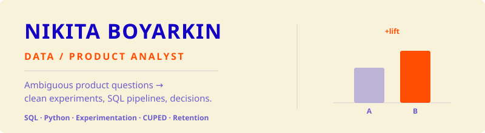
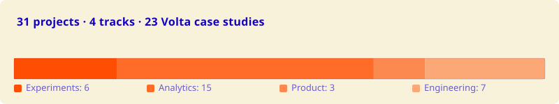
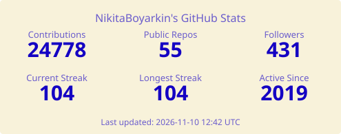
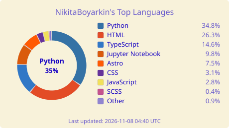
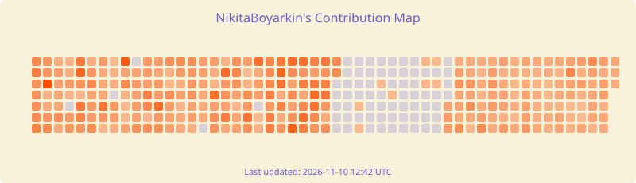
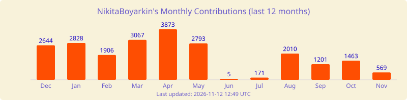
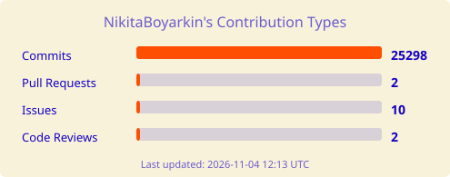
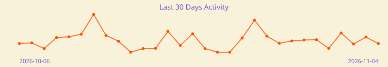

  

📦 **Portfolio:**   
🔗 **Links:** 

**Data / Product Analyst** — a working portfolio of experiments, SQL pipelines and retention analyses, each written up as a public case study.

**KYC A/B: +5.72 pp conversion** ([case study](https://nikitaboyarkin.github.io/projects/volta/ab/?utm_source=github&utm_medium=profile_readme&utm_campaign=header)) · **€208.5K A/B impact (12 mo) + €282K retention LTV** on synthetic Volta data (simulated bank, seeded figures) · **31 projects**, each with a public case study

---

### 📚 Currently

- 📚 Learning: Bayesian A/B testing, ClickHouse
- 💼 Open to: BI / product / data analyst roles — actively interviewing
- 🤝 Collab: experimentation, user retention analytics
- 🚧 Building: [interactive analyst portfolio](https://nikitaboyarkin.github.io/?utm_source=github&utm_medium=profile_readme&utm_campaign=building) — playable SVG games + self-hosted GitHub stats

<!-- ALL-PROJECTS:START -->
### 🗂️ All Projects

  

**31 projects** across **4 tracks** · **23 Volta case studies**

<table>
<tr>
<td width="50%" valign="top">

Analytics
<h3>RFM Analysis of Bank Clients</h3>

   

  

</td>
<td width="50%" valign="top">

Analytics
<h3>Python Analytics Playground</h3>

   

   

</td>
</tr>
<tr>
<td width="50%" valign="top">

Engineering
<h3>This Portfolio Site</h3>

   

   

</td>
<td width="50%" valign="top">

Experiments
<h3>A/B Testing Methodology Toolkit</h3>

   

   

</td>
</tr>
<tr>
<td width="50%" valign="top">

Analytics
<h3>Cohort Analysis Dashboard</h3>

   

   

</td>
<td width="50%" valign="top">

Experiments
<h3>Volta Neobank — Product Analytics</h3>

   

   

</td>
</tr>
<tr>
<td width="50%" valign="top">

Engineering
<h3>Digital Garden — EQ in IT</h3>

   

   

</td>
<td width="50%" valign="top">

Analytics
<h3>Sales Calls Analytics Dashboard</h3>

   

  

</td>
</tr>
<tr>
<td width="50%" valign="top">

Analytics
<h3>SQL Analytics Case Study</h3>

   

   

</td>
<td width="50%" valign="top">

Experiments
<h3>Browser Mini-Games — Analytics Arcade</h3>

   

   

</td>
</tr>
<tr>
<td width="50%" valign="top">

Analytics
<h3>ML Fundamentals — scikit-learn Pipeline</h3>

   

   

</td>
<td width="50%" valign="top">

Analytics
<h3>Classifieds liquidity — a measurability audit</h3>

  

   

</td>
</tr>
<tr>
<td width="50%" valign="top">

Engineering
<h3>Scrolly English Speaking</h3>

   

   

</td>
<td width="50%" valign="top">

Experiments
<h3>Causal / Uplift — CUPED and Individual Treatment Effects</h3>

   

   

</td>
</tr>
<tr>
<td width="50%" valign="top">

Experiments
<h3>CRM Experiment Lab — Segment-Stage Randomization, GCG and Net Effect</h3>

   

   

</td>
<td width="50%" valign="top">

Analytics
<h3>Churn Prediction — Leakage-Free Retention Model</h3>

   

   

</td>
</tr>
<tr>
<td width="50%" valign="top">

Analytics
<h3>Delivery Control Tower</h3>

   

   

</td>
<td width="50%" valign="top">

Analytics
<h3>Product A/B &amp; Funnel Analytics — Conversion versus Retention</h3>

  

   

</td>
</tr>
<tr>
<td width="50%" valign="top">

Analytics
<h3>Promo Margin Lab — what a promo rouble actually earns</h3>

   

   

</td>
<td width="50%" valign="top">

Analytics
<h3>RAG Evaluation Harness — retrieval and generation metrics</h3>

   

   

</td>
</tr>
<tr>
<td width="50%" valign="top">

Analytics
<h3>SERP Rank Lab</h3>

   

   

</td>
<td width="50%" valign="top">

Product
<h3>Product Analytics + A/B on Supabase</h3>

   

   

</td>
</tr>
<tr>
<td width="50%" valign="top">

Engineering
<h3>Airflow DAG Platform</h3>

   

   

</td>
<td width="50%" valign="top">

Engineering
<h3>ClickHouse — ten SQL cases on 50M rows</h3>

  

   

</td>
</tr>
<tr>
<td width="50%" valign="top">

Engineering
<h3>OSS catalog — 47 projects from one source</h3>

  

   

</td>
<td width="50%" valign="top">

Engineering
<h3>Matemarketing 2026 Programme — a static replica</h3>

   

   

</td>
</tr>
<tr>
<td width="50%" valign="top">

Experiments
<h3>Data Analyst Telegram Bot</h3>

  

   

</td>
<td width="50%" valign="top">

Analytics
<h3>GMV Drop RCA — root cause on real data</h3>

   

</td>
</tr>
<tr>
<td width="50%" valign="top">

Analytics
<h3>LinkedIn Content Analytics</h3>

  

   

</td>
<td width="50%" valign="top">

Product
<h3>Product Analytics Dashboard (Streamlit)</h3>

  

  

</td>
</tr>
<tr>
<td width="50%" valign="top">

Product
<h3>TaskFlow — PostHog Product Analytics Pipeline</h3>

  

   

</td>
<td width="50%" valign="top"></td>
</tr>
</table>

<b>🏦 Volta Neobank — 23 case studies</b>

<table>
<tr>
<td width="50%" valign="top">
Core
<h3>Volta — Funnel Analysis</h3>

  

</td>
<td width="50%" valign="top">
Core
<h3>Volta — KYC Progress-Bar A/B Test</h3>

  

</td>
</tr>
<tr>
<td width="50%" valign="top">
Core
<h3>Volta — Retention &amp; Cohorts</h3>

  

</td>
<td width="50%" valign="top">
Core
<h3>Volta — User Segmentation</h3>

  

</td>
</tr>
<tr>
<td width="50%" valign="top">
Extended
<h3>Volta — Churn Prediction</h3>

  

</td>
<td width="50%" valign="top">
Extended
<h3>Volta — RFM Analysis</h3>

  

</td>
</tr>
<tr>
<td width="50%" valign="top">
Extended
<h3>Volta — CLV Modeling</h3>

  

</td>
<td width="50%" valign="top">
Extended
<h3>Volta — Marketing Attribution</h3>

  

</td>
</tr>
<tr>
<td width="50%" valign="top">
Extended
<h3>Volta — Anomaly Detection</h3>

  

</td>
<td width="50%" valign="top">
Extended
<h3>Volta — Spend Analysis</h3>

  

</td>
</tr>
<tr>
<td width="50%" valign="top">
Extended
<h3>Volta — Support &amp; Churn</h3>

  

</td>
<td width="50%" valign="top">
Extended
<h3>Volta — NPS Trends</h3>

  

</td>
</tr>
<tr>
<td width="50%" valign="top">
Market jobs
<h3>Volta — JTBD × Cohorts</h3>

  

</td>
<td width="50%" valign="top">
Market jobs
<h3>Volta — Traveler Unit Economics</h3>

  

</td>
</tr>
<tr>
<td width="50%" valign="top">
Market jobs
<h3>Volta — Premium Upsell</h3>

  

</td>
<td width="50%" valign="top">
Market jobs
<h3>Volta — 45+ KYC Deep-Dive</h3>

  

</td>
</tr>
<tr>
<td width="50%" valign="top">
Market jobs
<h3>Volta — Referral Segments</h3>

  

</td>
<td width="50%" valign="top">
RAT v2
<h3>Volta — Assisted CAC vs LTV</h3>

  

</td>
</tr>
<tr>
<td width="50%" valign="top">
RAT v2
<h3>Volta — FX Sourcing Feasibility</h3>

  

</td>
<td width="50%" valign="top">
RAT v2
<h3>Volta — Segment Premium Offers</h3>

  

</td>
</tr>
<tr>
<td width="50%" valign="top">
RAT v2
<h3>Volta — Anchor Launch CAC at Scale</h3>

  

</td>
<td width="50%" valign="top">
RAT v2
<h3>Volta — Dormant 45+ Win-back</h3>

  

</td>
</tr>
<tr>
<td width="50%" valign="top">
Causal
<h3>Volta — Causal Validation of KYC (DiD)</h3>

  

</td>
<td width="50%" valign="top"></td>
</tr>
</table>

<!-- ALL-PROJECTS:END -->

---

### ⚡ Activity

<!-- LAST-REFRESHED:START -->
_Last refreshed: 2026-11-11 11:54 UTC · 276 contributions in the last 7 days_
<!-- LAST-REFRESHED:END -->

<b>📊 Stats, streaks, contribution map, languages and monthly trend</b>

  

  

  

  

  

  

  <picture>
    <source media="(prefers-color-scheme: dark)" srcset="https://raw.githubusercontent.com/NikitaBoyarkin/NikitaBoyarkin/main/github-contribution-grid-snake-dark.svg" />
    
  </picture>

  

---

### 📝 Recent Notes

<!-- RECENT-POSTS-LIST:START -->
- [Кейс Volta: воронка, A/B и retention на синтетике необанка](https://nikitaboyarkin.github.io/posts/volta-neobank-case-study/?utm_source=github&utm_medium=profile_readme&utm_campaign=notes)
- [Кейсы с собеседований: как диагностировать просадку метрики](https://nikitaboyarkin.github.io/posts/analyst-interview-cases/?utm_source=github&utm_medium=profile_readme&utm_campaign=notes)
- [Проактивность аналитика за рамками роли](https://nikitaboyarkin.github.io/posts/analyst-proactivity/?utm_source=github&utm_medium=profile_readme&utm_campaign=notes)
- [Churn + uplift: кому дать скидку &lpar;причинный таргетинг&rpar;](https://nikitaboyarkin.github.io/posts/churn-uplift-discount/?utm_source=github&utm_medium=profile_readme&utm_campaign=notes)
- [EDA-шаблон с кодом: разведочный анализ по-продуктовому](https://nikitaboyarkin.github.io/posts/eda-python-template/?utm_source=github&utm_medium=profile_readme&utm_campaign=notes)
<!-- RECENT-POSTS-LIST:END -->

> Auto-updated daily from the [site RSS](https://nikitaboyarkin.github.io/rss.xml) via GitHub Actions.

---

### 🛠️ Tech Stack

**Languages**

**Data & Machine Learning**

**Storage & Pipelines**

**BI & Product Analytics**

**Shipping & Quality**

**Web & Publishing**

Exploring next: ClickHouse · Bayesian A/B testing · real-time pipelines — every other badge above ships in one of the 31 projects.

---

### 🌐 Connect

---

<b>🧩 How this profile is built — situation, task, actions, result</b>

**Situation.** The work lived across many repositories — experiments, SQL, retention, segmentation — each with its own numbers and no single reachable page tying a method to the result it produced.

**Task.** Turn that body of work into a profile a recruiter can navigate in one scroll: headline cases with real numbers, a public case study per project, and a portfolio site that demonstrates the analytics rather than describing it.

**Actions.** Published the work end-to-end. Projects are grouped into Experiments / Analytics / Product / Engineering, the Volta flagship carries 23 linked sub-cases, and the portfolio site at https://nikitaboyarkin.github.io renders every case study. In the site, headline numbers are frozen in `src/lib/metrics.ts` and CI-checked; profile cards and stats are self-hosted via `scripts/build_profile.py`.

**Result.** A public portfolio site plus a self-hosted profile: 10 playable SVG mini-games, the Volta flagship at +5.72 pp KYC conversion, €208.5K A/B impact (12 mo) and €282K retention LTV, and a case study that links each method back to the repository that produced it.

Profile cards (stats, activity, contribution map, contribution types, monthly activity, top languages) are self-hosted via `scripts/build_profile.py`. Powered by [snk](https://github.com/Platane/snk), [blog-post-workflow](https://github.com/gautamkrishnar/blog-post-workflow), [skill-icons](https://github.com/tandpfun/skill-icons), [shields.io](https://shields.io).
